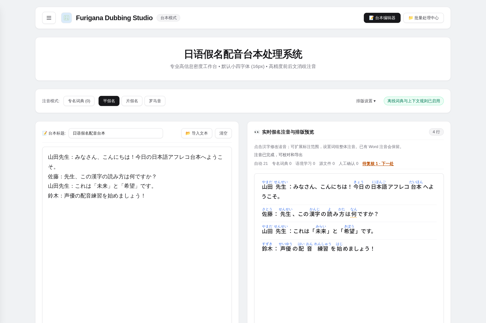

<div align="center">

  

  # 浮く · Uku Furigana

  面向日语学习者的离线振假名（ルビ）注音与排版工具。解决多音字误读、量词音变、熟字训拆裂与 Word 排版错位问题。

  <p>
    <b>简体中文</b> • <a href="README_EN.md">English</a>
  </p>

  [](LICENSE)
  [](RELEASE_NOTES.md)
  [](https://nextjs.org/)
  [](https://tailwindcss.com/)
  [](https://github.com/Cheese-nya/uku-furigana)

</div>

---

## 解决的问题

常规假名注音工具直接查词典，常出现以下错误：

| 场景 | 常见错误 | 本工具处理 |
| :--- | :--- | :--- |
| **多音字** | `辛い` 读音混淆（辣 vs 痛苦） | 结合前后文助词自动区分 `からい` 与 `つらい`；`何`（なに/なん）、`風`（かぜ/ふう）同理 |
| **量词变音** | `一発`、`一本` 读成 いちはつ、いちほん | 内置数词量词音变规则，正确输出 `いっぱつ`、`いっぽん`、`三分(さんぷん)` 等促音与半浊音 |
| **熟字训** | `二人` 被拆成 `二(に)人(にん)` | 识别整体词组，注为 `二人(ふたり)`、`大人(おとな)`；动词送假名精确对齐 |
| **打印排版** | 导出到 Word 后假名掉落或变成括号 | 输出标准 Word `<w:ruby>` 结构，假名居中在汉字上方，字号与行距可调 |

100% 本地运行，离线可用，不上传任何文本。

---

## 界面预览

### 主工作台
左侧输入原文，右侧实时显示注音排版。支持平假名、片假名、罗马音切换与长文分页。

<p align="center">
  
</p>

### 点击校对与词组整体注音
点击汉字弹出候选读音与所在短句。支持向右扩展圈选词组（如将「二」扩展为「二人」并注「ふたり」）。确认后的读音会自动学习到当前台本相同语境中。

<p align="center">
  
</p>

### 专名词典
管理角色名、地名等特殊读音。长词匹配优先，支持 JSON 导入导出。

<p align="center">
  
</p>

### 批量处理
支持批量导入 `.txt`、`.srt`、`.docx`，按文件名自动提取标题并并行注音导出。

<p align="center">
  
</p>

---

## 功能清单

- **上下文形态素引擎**：基于本地 Kuromoji，集成多音字消除规则与量词音变表。
- **三种注音视角**：平假名（初学）、片假名（进阶）、罗马音（拼读辅助）。
- **Web Worker 异步处理**：后台分词计算，大段文本输入不卡顿；实时进度显示与防抖中断。
- **交互式校对**：
  - 点击汉字直接修改，展示前后文短句对照。
  - 支持向右扩展词组整体标注。
  - 语境记忆：同篇文本内相同语境的词自动套用校对结果。
  - 优先级：人工校对 > 原文自带注音 > 语境记忆 > 专名词典 > 自动分词。
- **多格式导入与导出**：
  - **Word (`.docx`)**：原生 `<w:ruby>` 上标排版，支持导入已带注音的 Word 文档。
  - **字幕 (`.srt`)**：保留时间轴与分段，导出带注音字幕。
  - **纯文本 (`.txt`)**：干净的纯文本标注。
- **数据持久化**：基于文本内容 SHA-256 指纹索引，修改标题不丢失校对记录。

---

## 快速上手

### 依赖与启动

```bash
git clone https://github.com/Cheese-nya/uku-furigana.git
cd uku-furigana
npm install
npm run dev
```

浏览器打开 `http://localhost:3000`。

### 运行测试

```bash
npm test
```

### 打包 Windows 单文件 EXE

在 Windows 环境下执行：

```bash
pip install pywebview pyinstaller
npm run package:exe
```

在根目录生成绿色单文件 `UkuFurigana.exe`。

---

## 技术栈

- **前端**：Next.js 16 + React 19 + Tailwind CSS v4
- **分词引擎**：Kuromoji.js（Web Worker 离线运行）
- **文档处理**：docx、JSZip、xmldom
- **桌面包装**：PyWebView (WebView2) + PyInstaller

---

## 目录结构

```text
furigana/
├── app/
│   ├── components/      # UI 组件（Sidebar, Modal, GlossaryModal 等）
│   ├── utils/           # 分词引擎、消歧规则、Word/SRT 导入导出
│   ├── workers/         # 独立 Web Worker
│   └── page.tsx         # 核心交互页面
├── docs/images/         # 界面截图与说明文档
├── public/dict/         # 离线分词词典数据
├── tests/               # 自动化单元测试
└── desktop_runner.py    # 桌面版桥接入口
```

---

## 许可协议

- **源代码**：自 v1.2.0 之后的提交起，以 [PolyForm Noncommercial 1.0.0](LICENSE) 许可发布。允许个人学习、研究、教学及其它**非商业**用途下的使用、修改与分发；**禁止任何商业用途**。如需商业授权，请联系作者。
- **历史版本**：v1.2.0（提交 `6b3804a`）及更早的版本曾以 MIT 协议发布，这些版本仍适用 MIT。
- **名称与图标**：不在上述许可范围内，见 [TRADEMARKS.md](TRADEMARKS.md)。
- **第三方组件**：见 [THIRD_PARTY_NOTICES.md](THIRD_PARTY_NOTICES.md)。
- **参与贡献**：见 [CONTRIBUTING.md](CONTRIBUTING.md) 与 [CLA.md](CLA.md)。
