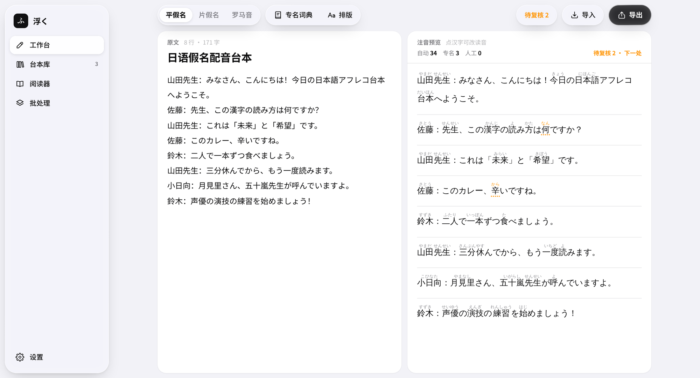
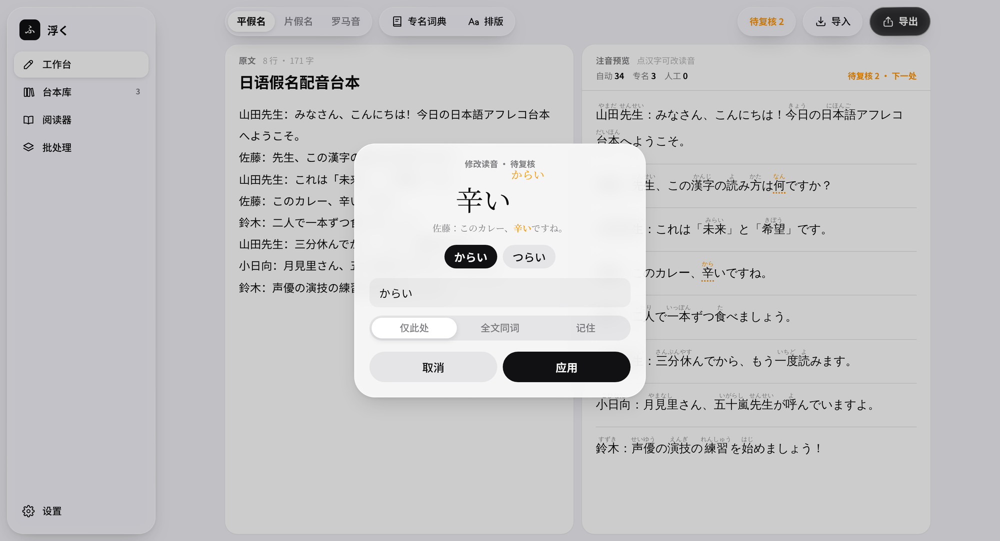
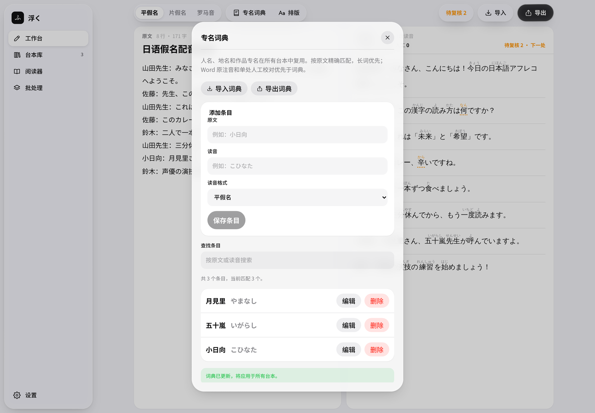
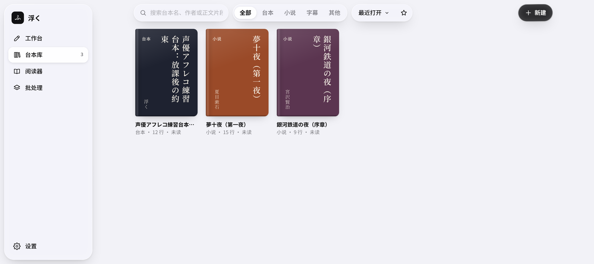
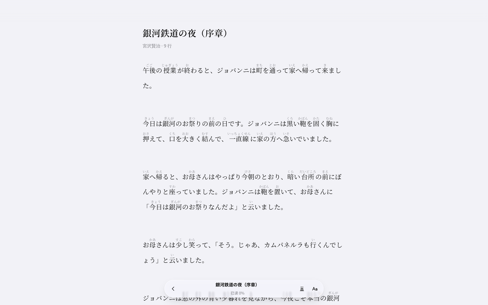
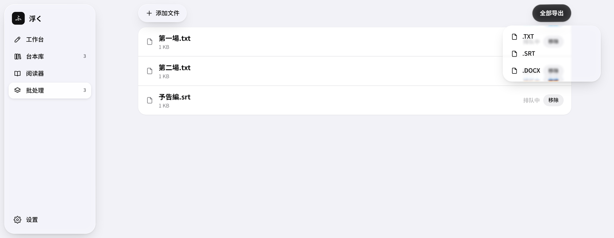
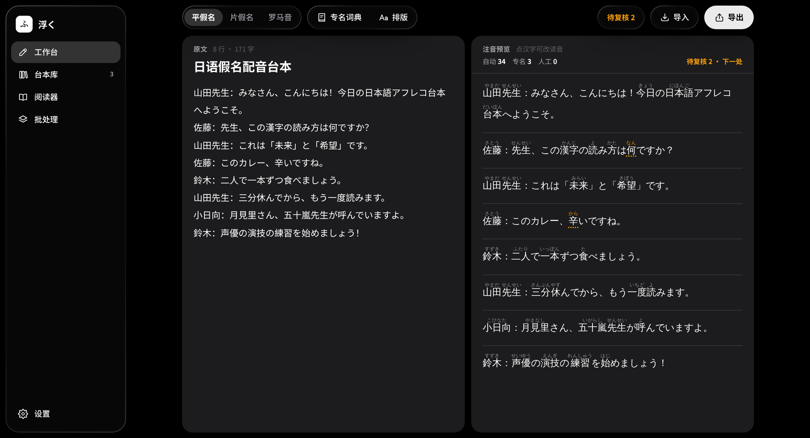
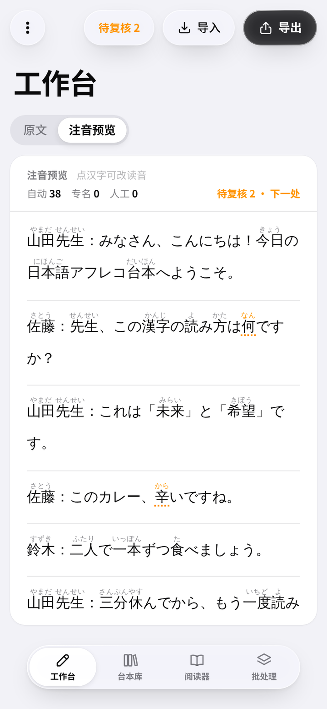
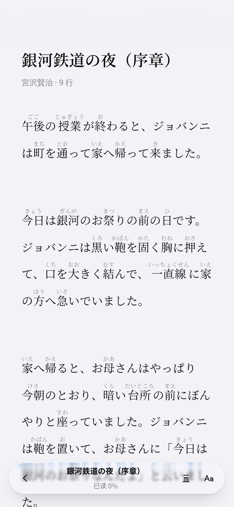

<div align="center">

  

  # Uku Furigana (浮く)

  **Furigana that floats above the kanji.**

  An offline Japanese furigana (ruby) annotation and typesetting tool for learners and voice-acting practice.<br />
  Homograph misreadings, counter sound changes, compound words, and Word ruby misalignment, handled.

  <p>
    <b>English</b> • <a href="README.md">简体中文</a>
  </p>

  [](https://github.com/Cheese-nya/uku-furigana/releases/latest)
  [](https://github.com/Cheese-nya/uku-furigana/actions/workflows/ci.yml)
  [](LICENSE)
  [](#download)

  <br />

  

</div>

---

## Download

Pick your platform on the [Releases](https://github.com/Cheese-nya/uku-furigana/releases/latest) page:

| Platform | File | Notes |
| :--- | :--- | :--- |
| **Windows** | `Uku-Furigana-vX.Y.Z-windows.exe` | Portable single-file desktop app |
| **Android** | `Uku-Furigana-vX.Y.Z.apk` | Android 7.0 or later |
| **Web** | `Uku-Furigana-web-vX.Y.Z.zip` | Static web bundle you can host yourself |
| **iOS** | — | Native shell is done; store release in preparation |

Every release ships a `SHA256SUMS.txt`. The Windows build is not code-signed yet, so SmartScreen may show a warning on first launch.

---

## Problems Solved

Tools that simply look words up in a dictionary often get these wrong:

| Category | Typical error | How Uku handles it |
| :--- | :--- | :--- |
| **Homographs (多音字)** | `辛い` misread (spicy vs. painful) | Uses the surrounding particles to tell `からい` from `つらい`; resolves `何` (なに / なん) and `風` (かぜ / ふう) the same way |
| **Counter sound changes (量词音变)** | `一発` / `一本` read as *ichihatsu* / *ichihon* | Built-in counter rules produce `いっぱつ`, `いっぽん`, `三分 (さんぷん)` with the right gemination and p-sounds |
| **Jukujikun and compounds (熟字訓)** | `二人` split into `二(に)人(にん)` | Recognizes the whole word (`二人` → `ふたり`, `大人` → `おとな`) and aligns okurigana in verbs precisely |
| **Print and export** | Ruby drops into brackets or misaligns in Word | Writes native Word `<w:ruby>` markup, centered above the kanji, with adjustable size and line spacing |

Annotation and export run entirely on your machine. No text is uploaded, and it works offline (only importing from Pixiv needs a connection).

---

## Screenshots

### Click-to-correct

Click any annotated kanji to see candidate readings and the clause it sits in. Apply a change to just that spot, to every occurrence in the script, or remember it as a context. You can also extend the selection to the right to annotate a whole word, for example turning `二` into `二人` read as `ふたり`.

<p align="center">
  
</p>

The "To review" counter at the top right lists words the engine is unsure about. Step through them with "Next".

### Proper-noun glossary

Add names, places, and work-specific readings once and reuse them in every script. Exact match, longest word first, with import and export.

<p align="center">
  
</p>

### Library and reader

Imported scripts, novels, and subtitles live in a library that remembers your corrections by content, so renaming a title never loses them. Three samples are built in (a dubbing script and two public-domain novels). The reader adjusts font and size, toggles furigana, and supports vertical writing.

<p align="center">
  
</p>

<p align="center">
  
</p>

### Batch processing

Drop in several `.txt`, `.srt`, or `.docx` files, annotate them in parallel, then export them all in one format.

<p align="center">
  
</p>

### Dark mode and phones

Appearance follows the system, or pick one yourself. On phones a bottom tab bar replaces the sidebar, and the source and the preview are separate pages.

<p align="center">
  
</p>

<p align="center">
  
  &nbsp;&nbsp;
  
</p>

---

## Features

- **Context-aware morphological engine**: offline Kuromoji with custom disambiguation rules and a counter lexicon.
- **Three notations**: hiragana (learners), katakana (advanced and loanwords), romaji (pronunciation aid).
- **Background tokenization**: runs in a Web Worker so typing long text stays smooth; newer input cancels stale work.
- **Interactive review**:
  - Click a kanji to adjust it against the sentence.
  - Extend the selection to annotate a whole word.
  - Context memory: corrections apply to identical contexts in the same script.
  - Priority: manual correction › ruby already in the source › learned context › glossary › engine.
- **Import and export**:
  - **Word (`.docx`)**: native `<w:ruby>` layout; imports documents that already contain ruby.
  - **Subtitles (`.srt`)**: keeps timecodes and multi-line cues and exports annotated subtitles; `.vtt` can be imported too.
  - **Plain text (`.txt`)**: clean bracketed furigana.
- **Library, reader, batch processing**: see the screenshots above.
- **Your data stays local**: indexed by a SHA-256 fingerprint of the text, so renames and re-imports keep your corrections.

---

## Run from Source

```bash
git clone https://github.com/Cheese-nya/uku-furigana.git
cd uku-furigana
npm install
npm run dev
```

Open `http://localhost:3000`.

```bash
npm test             # unit tests
npx tsc --noEmit     # type check
npm run lint
npm run build:web    # static web bundle in out/
```

### Packaging

| Target | Command | Needs |
| :--- | :--- | :--- |
| Windows exe | `pip install -r requirements-desktop.txt`, then `npm run package:exe` | Windows, Python 3.12, Node 22 |
| Android APK | `ANDROID_KEYSTORE=<your key> bash scripts/build-apk.sh` (prompts for the password) | Android SDK, JDK 17 |

See [docs/RELEASING.md](docs/RELEASING.md) for the release process (written in Chinese).

---

## Tech Stack

- **Frontend**: Next.js 16 + React 19 + Tailwind CSS v4
- **Morphological engine**: Kuromoji.js running offline in a Web Worker
- **Documents**: docx, JSZip, xmldom
- **Windows**: PyWebView (WebView2) + PyInstaller
- **Android**: native WebView shell (Java), packaged directly by a script
- **iOS**: Capacitor

---

## Project Structure

```text
uku-furigana/
├── app/
│   ├── components/      # UI (sidebar, correction dialog, library, reader, batch, ...)
│   ├── hooks/           # theme, library, and batch state logic
│   ├── utils/           # engine, disambiguation rules, docx/srt import-export, library storage
│   ├── workers/         # annotation Web Worker
│   ├── api/             # server route for Pixiv import (excluded from the static export)
│   └── page.tsx         # page entry
├── android/             # Android shell (manifest, resources, Java sources)
├── ios/                 # iOS shell (Capacitor)
├── scripts/             # build and release scripts
├── public/dict/         # offline dictionary
├── tests/               # automated tests
├── docs/                # screenshots, brand assets, release process, dev notes
└── desktop_runner.py    # Windows desktop entry point
```

---

## License

- **Source code**: from v1.2.0 on (starting at commit `a9c33a2`) it is licensed under [PolyForm Noncommercial 1.0.0](LICENSE). Personal, educational, research, and other **noncommercial** use, modification, and distribution are permitted; **commercial use is not**. Contact the author for a commercial license.
- **Earlier versions**: previous commits, including the released v1.1.0, were published under the MIT License and remain available under MIT.
- **Name and icons**: not covered by the license; see [TRADEMARKS.md](TRADEMARKS.md).
- **Third-party components**: see [THIRD_PARTY_NOTICES.md](THIRD_PARTY_NOTICES.md).
- **Contributing**: see [CONTRIBUTING.md](CONTRIBUTING.md) and the [CLA](CLA.md).
