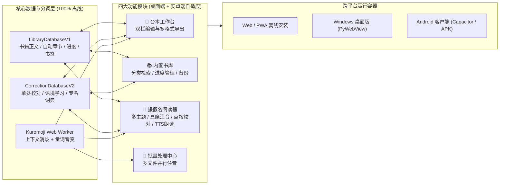

# Furigana Dubbing Studio — 内置书库、阅读器与安卓端支持策划及实施任务书

> **文档状态**：✅ 全部完成并通过多轮验收（由 Antigravity 统筹策划、Open Design 审计把关，交由 `pi` Agent 循环实施）
> **最后更新**：2026-10-19 08:31 (UTC+8)
> **特别提示（断点续跑说明）**：调用 `pi` CLI 时**必须**附带 `--no-mcp --no-extensions -a -p` 参数（即 `pi --no-mcp --no-extensions -a -p '...'`），否则 `pi` 默认会加载重型 MCP 服务并卡在目录信任交互确认。

---

## 一、 总体架构与产品策划

本项目在现有「离线振假名工作台 + 批量处理中心」基础上，新增 **内置书库 (Built-in Library)**、**沉浸式振假名阅读器 (Furigana Reader)** 以及 **安卓端支持 (Android Support: Mobile UX + PWA + Capacitor Android)**，打造「导入/编辑 ↔ 书库沉淀 ↔ 沉浸阅读/听力跟读 ↔ 多端离线使用」的完整闭环。



---

## 二、 核心功能详细设计

### 1. 内置书库模块 (`LibraryDatabaseV1` & `LibraryPanel`)
- **数据结构 (`app/utils/libraryDatabase.ts`)**：
  - `BookItem`：
    - `bookId`: `string`（格式 `book:<UUID>`）
    - `title`: `string`
    - `author`: `string`
    - `category`: `'script' | 'novel' | 'subtitle' | 'other'`
    - `format`: `'txt' | 'srt' | 'docx'`
    - `coverTheme`: `'indigo' | 'emerald' | 'amber' | 'rose' | 'slate'`
    - `content`: `string`（完整原文）
    - `fingerprint`: `string`（SHA-256 指纹，与 `CorrectionDatabaseV2` 的 `scriptId` 自动关联，实现校对记录互通）
    - `sourceOverrides`: `RubyOverride[]`（保留导入 `.docx` 时的原有注音）
    - `srtCues`: `SrtCue[]`（保留导入 `.srt` 时的字幕时间轴）
    - `chapters`: `BookChapter[]`（包含 `id`, `title`, `startLine`, `endLine`）
    - `readingProgress`: `{ chapterIndex: number; lineIndex: number; percentage: number; updatedAt: number }`
    - `bookmarks`: `BookmarkItem[]`（包含 `id`, `lineIndex`, `chapterIndex`, `label`, `snippet`, `createdAt`）
    - `favorite`: `boolean`
    - `createdAt`: `number`
    - `updatedAt`: `number`
    - `lastReadAt`: `number`
- **智能章节切分 (`extractChapters`)**：
  - 自动识别日文/中文/英文常见章节标题行（如 `第[一二三四五六七八九十百千0-9]+[章話话節节回幕部]`、`Chapter \d+`、`Episode \d+`、`【.*?】`、`■.*` 等）。
  - 若长文无显式章节标题且超过 120 行，自动按每 100 行切分为「第 1 節」「第 2 節」等阅读分段，保证大体积轻小说在移动端阅读流畅不卡顿。
- **开箱即用示例书籍 (`createStarterBooks`)**：
  - 首次初始化书库时内置 3 部精选日语读物：
    1. 『声優アフレコ練習台本：放課後の約束』（动画配音对话台本，含多音字与量词练习）
    2. 夏目漱石『夢十夜（第一夜）』节选（经典文学名篇）
    3. 宮沢賢治『銀河鉄道の夜（序章）』节选（经典童话文学）
- **多后端持久化 (`app/utils/libraryStorage.ts`)**：
  - 优先使用浏览器 `IndexedDB`（库名 `furigana-library-db`，存储空间大，支持数万行轻小说），并在不支持 `IndexedDB` 的环境自动回退至 `localStorage`（键名 `furigana-library-v1`）。
  - 支持桌面端 `pywebview.api` 扩展存储接口（若存在 `load_library_database` / `save_library_database` 则同步调用）。
  - 支持书库完整 JSON 导出与导入合并。

### 2. 内置振假名阅读器模块 (`ReaderPanel`)
- **四种假名显示模式（专为日语学习设计）**：
  - `all`（全部显音）：所有汉字上方常驻显示振假名（支持平假名 / 片假名 / 罗马音一键切换）。
  - `touch_reveal`（轻触/悬停显音 - **背诵与阅读训练模式**）：默认隐藏或半透明模糊假名，当手指轻触或鼠标悬停在词组上时清晰浮现假名；再次点击已展开词组可打开校对弹窗。
  - `review_only`（仅重难点显音）：仅展示多音字待复核词 (`needsReview`)、人工校对词 (`manual`) 与专名词典词 (`glossary`) 的假名。
  - `none`（纯享原文）：隐藏所有假名，锻炼纯汉字阅读能力。
- **四大护眼阅读主题**：
  - `light`（纯白明亮）、`sepia`（暖色羊皮纸）、`mint`（护眼豆沙绿）、`dark`（夜间深邃暗黑）。
- **排版与字体控制**：
  - 正文字号 (`14px` ~ `32px`)、假名字号 (`8px` ~ `18px`)、行间距 (`1.4x` ~ `3.0x`)。
  - 字体切换：ゴシック体（无衬线清晰配音风） vs 明朝体（衬线文学书籍风）。
  - 角色名高亮：自动识别台本中的 `角色名：` 并以独立色标渲染。
- **目录导航、书签与全文检索**：
  - 侧滑/弹出式「章节目录」与「我的书签」面板。
  - 每行右侧提供快捷操作：添加/移除书签、单句日语 TTS 朗读。
  - 书内关键词搜索：输入日文或假名即可过滤定位到匹配行并点击跳转。
- **原位校对与 Web Speech TTS 朗读**：
  - 阅读器中点击任意汉字词组可调用 `RubyCorrectionModal` 修改读音，修改结果实时写回 `CorrectionDatabaseV2`。
  - 内置离线 TTS 朗读控制器（基于系统 `window.speechSynthesis` `ja-JP` 语音）：支持单句朗读、从当前行连续朗读本章、语速调节 (`0.75x` / `1.0x` / `1.25x`) 与当前朗读行高亮跟随。

### 3. 安卓端与移动端适配 (`Mobile UX + PWA + Capacitor Android`)
- **移动端响应式与底部导航栏 (`MobileNavBar`)**：
  - 在手机/平板竖屏下提供底部固定导航栏（`📝 工作台`、`📚 书库`、`📖 阅读器`、`📁 批处理`），适配安全区域 `env(safe-area-inset-bottom)`。
  - 阅读器支持移动端沉浸式顶栏/底栏收起，按钮触控区域不小于 `44px`。
- **PWA 离线安装支持**：
  - 提供 `public/manifest.json` 与 `app/layout.tsx` 移动端 viewport / apple-mobile-web-app / themeColor 元数据。
- **Android 原生打包链路 (Capacitor + 本机 Android SDK)**：
  - 提供 `capacitor.config.ts` 与 Android 平台脚本，将 Next.js `out/` 静态产物封装为原生 Android 工程，并兼容移动端文件导出/分享 (`navigator.share` / 文件下载回退)。

---

## 三、 分步实施计划与验收清单 (Step-by-Step Execution Plan)

| 阶段 | 任务名称 | 核心产出文件 | 验收标准 | 当前状态 |
| :--- | :--- | :--- | :--- | :--- |
| **Step 1** | 书库数据引擎、章节切分器、内置示例书与持久化层 | `app/utils/libraryDatabase.ts`<br>`app/utils/libraryStorage.ts`<br>`tests/libraryDatabase.test.mjs` | `npm test` 全部通过（67/67 单元测试通过），`npx tsc --noEmit` 零错误 | ✅ **已完成并验收通过** |
| **Step 2** | 国际化词条扩展与内置书库 UI 面板 | `app/utils/i18n.ts`<br>`app/components/LibraryPanel.tsx` | 书库面板支持搜索、分类过滤、导入 `.txt/.srt/.docx`、收藏、进度展示、JSON 备份导入导出，`npx tsc --noEmit` 通过 | ✅ **已完成并验收通过** |
| **Step 3** | 内置沉浸式振假名阅读器 UI 面板 | `app/components/ReaderPanel.tsx` | 支持四大主题、四种显音模式（含轻触显音）、字体切换、章节跳转、书签管理、书内搜索、TTS 朗读、点击汉字校对联动，`npx tsc --noEmit` 通过 | ✅ **已完成并验收通过** |
| **Step 4** | 主工作台闭环整合、移动端底部导航与社交方块快捷按钮 | `app/page.tsx`<br>`app/components/Sidebar.tsx`<br>`app/components/MobileNavBar.tsx` | 四大 Tab 切换流畅；工作台支持「存入书库」与「在阅读器打开」；顶部与侧边栏新增 Twitter/X (`https://x.com/beimisama`) 与 GitHub (`https://github.com/Cheese-nya/furigana`) 方块快捷按钮；移动端底部导航栏自适应 | ✅ **已完成并验收通过** |
| **Step 5** | 安卓端 PWA 配置、文件分享兼容、Android 构建链路与多轮 UI/UX 精修 | `public/manifest.json`<br>`app/layout.tsx`<br>`app/utils/fileSave.ts`<br>`capacitor.config.ts`<br>`desktop_runner.py`<br>`tests/libraryStorageAndIntegration.test.mjs` | `npx tsc --noEmit` (0 错误)、`npm run lint` (0 错误 0 警告)、`npm test` (81/81 通过)、Python 桌面存储测试 (7/7 通过)、`npm run build` 静态导出成功 | ✅ **已完成并验收通过** |

---

## 四、 后续步骤 `pi` Agent 标准派发指令 (可直接复制用于断点续跑)

### Step 3 派发指令（内置振假名阅读器 `app/components/ReaderPanel.tsx`）
```bash
pi --no-mcp --no-extensions -a -p 'Execute Step 3 of docs/dev-notes/reader-library-android-plan.md in the repository root:
Create `app/components/ReaderPanel.tsx`:
- Export types:
  - `ReaderTheme = "light" | "sepia" | "mint" | "dark"`
  - `RubyVisibilityMode = "all" | "touch_reveal" | "review_only" | "none"`
  - `ReaderFontFamily = "sans" | "serif"`
- Props interface `ReaderPanelProps`:
  - `t: Translations`
  - `book: BookItem | null`
  - `annotatedLines: ScriptLine[]`
  - `isProcessing: boolean`
  - `rubyType: "hiragana" | "katakana" | "romaji"`
  - `onRubyTypeChange: (mode: "hiragana" | "katakana" | "romaji") => void`
  - `fontSize: number`
  - `onFontSizeChange: (size: number) => void`
  - `rubyFontSize: number`
  - `onRubyFontSizeChange: (size: number) => void`
  - `lineSpacing: number`
  - `onLineSpacingChange: (spacing: number) => void`
  - `onTokenClick: (lineIndex: number, tokenIndex: number) => void`
  - `onUpdateProgress: (chapterIndex: number, lineIndex: number) => void`
  - `onAddBookmark: (lineIndex: number, label?: string) => void`
  - `onRemoveBookmark: (bookmarkId: string) => void`
  - `onGoToLibrary: () => void`
  - `onGoToEditor: (book?: BookItem) => void`
- Features:
  1. Empty state if `book === null` with buttons to open Library (`onGoToLibrary`) or Editor (`onGoToEditor`).
  2. Theme styling:
     - `light`: `bg-white text-zinc-900 border-zinc-200`
     - `sepia`: `bg-[#fbf6ec] text-[#3d3124] border-[#e6dac3]`
     - `mint`: `bg-[#eef6f0] text-[#1e3326] border-[#cde2d3]`
     - `dark`: `bg-zinc-900 text-zinc-100 border-zinc-800`
     Persist theme, rubyVisibilityMode, and fontFamily in `localStorage`.
  3. Top reader toolbar:
     - Back to Library button, Book Title + current Chapter badge, Edit in Studio button.
     - Drawers/Popovers for:
       - Table of Contents (`book.chapters`): clicking a chapter switches to that chapter and calls `onUpdateProgress(idx, chapter.startLine)`.
       - Bookmarks (`book.bookmarks`): clicking a bookmark jumps to its chapter & line; delete button removes bookmark.
       - In-book Search: input that searches across `book.content` lines and lets user jump to matching line/chapter.
       - Appearance & Ruby Settings:
         - Theme selector (`light`, `sepia`, `mint`, `dark`)
         - Ruby visibility mode (`all`, `touch_reveal`, `review_only`, `none`)
         - Ruby script type (`hiragana`, `katakana`, `romaji`)
         - Font family (`sans` vs `serif`)
         - Font size, Ruby font size, Line spacing sliders.
  4. Chapter pagination & rendering:
     - Slice `annotatedLines` for the current chapter `[currentChapter.startLine, currentChapter.endLine]`.
     - For each line:
       - Show line number, bookmark toggle button (`🔖`), and single-line TTS speak button (`🔊`).
       - Detect speaker prefix (`角色名：`) and highlight speaker name badge.
       - Render tokens with `<ruby>`:
         - In `all` mode: show ruby normally; clicking token triggers `onTokenClick(globalLineIdx, tokenIdx)`.
         - In `touch_reveal` mode: keeps track of `revealedTokens: Set<string>` (`${globalLineIdx}:${tokenIdx}`). If not revealed, ruby text is blurred/invisible (`opacity-0 group-hover:opacity-100`); first tap on mobile reveals it (`revealedTokens.add(key)`), second tap calls `onTokenClick(globalLineIdx, tokenIdx)`.
         - In `review_only` mode: only show ruby when `token.needsReview || token.source === "manual" || token.source === "glossary" || token.source === "learned"`.
         - In `none` mode: hide `<rt>` text completely.
  5. Built-in Japanese Web Speech API (`window.speechSynthesis`) controller:
     - Play/Stop current chapter sequentially from current line, with speed toggle (`0.75x`, `1.0x`, `1.25x`) and active speaking line highlight.
     - Clean up `speechSynthesis.cancel()` on unmount or book change.
  6. Bottom chapter navigation bar (`Prev Chapter` / `Chapter X of Y (Progress %)` / `Next Chapter`).
Verify with `npx tsc --noEmit` and `npm test`.'
```

### Step 4 派发指令（主工作台闭环整合与移动端导航 `app/page.tsx` + `Sidebar.tsx` + `MobileNavBar.tsx`）
```bash
pi --no-mcp --no-extensions -a -p 'Execute Step 4 of docs/dev-notes/reader-library-android-plan.md in the repository root:
1. Create `app/components/MobileNavBar.tsx`:
   - Fixed bottom navigation bar on mobile (`lg:hidden fixed bottom-0 inset-x-0 z-30 bg-white/95 backdrop-blur border-t border-zinc-200 pb-[env(safe-area-inset-bottom)]`).
   - 4 tabs: `editor` (📝), `library` (📚 with book count badge), `reader` (📖), `batch_files` (📁).
2. Update `app/components/Sidebar.tsx`:
   - Update `activeTab` union type to `"editor" | "library" | "reader" | "batch_files" | "deps"`.
   - Add navigation items for `sidebarLibrary` (📚) and `sidebarReader` (📖).
3. Update `app/page.tsx`:
   - Load and persist `LibraryDatabaseV1` using `loadLibrary()` and `saveLibrary()` from `./utils/libraryStorage`.
   - Manage `libraryDb` state and `activeBookId` state (defaulting to first book in `libraryDb.books` if available).
   - Expand `activeTab` to `"editor" | "library" | "reader" | "batch_files" | "deps"`.
   - Update desktop top header tab switcher to include 4 tabs: `editorTab`, `libraryTab`, `readerTab`, `batchTab`.
   - In the Editor pane header:
     - Add "💾 Save to Library" (`saveToLibraryButton`) which calls `upsertBook` with current `docTitle`, `inputText`, `sourceOverrides`, `srtCues`, saves to library, and shows a brief confirmation notice.
     - Add "📖 Open in Reader" (`openInReaderButton`) which upserts the current script into `libraryDb`, sets it as `activeBookId`, and switches `activeTab` to `"reader"`.
   - When `activeTab === "reader"` and an active book is selected:
     - Ensure the furigana worker annotates the active book (or syncs `inputText`/`docTitle`/`sourceOverrides`/`srtCues` when opening a book in Reader/Editor so `RubyCorrectionModal` and `CorrectionDatabaseV2` work seamlessly in both Editor and Reader!).
   - Wire up `LibraryPanel`, `ReaderPanel`, and `MobileNavBar` with all handlers (`onOpenInReader`, `onOpenInEditor`, `onImportFiles`, `onCreateOrUpdateBook`, `onToggleFavorite`, `onDeleteBook`, `onExportBackup`, `onImportBackup`, `onResetStarterBooks`, `onUpdateProgress`, `onAddBookmark`, `onRemoveBookmark`).
Verify with `npx tsc --noEmit` and `npm test`.'
```

### Step 5 派发指令（安卓端 PWA、文件导出分享兼容与 Capacitor 配置）
```bash
pi --no-mcp --no-extensions -a -p 'Execute Step 5 of docs/dev-notes/reader-library-android-plan.md in the repository root:
1. Create `public/manifest.json` for PWA installation on Android/desktop.
2. Update `app/layout.tsx` to include mobile-friendly `viewport` export (`width: "device-width", initialScale: 1, viewportFit: "cover", themeColor: "#18181b"`) and `manifest: "/manifest.json"`.
3. Update `app/utils/fileSave.ts` so that on Android/mobile browsers or Capacitor WebView where `showSaveFilePicker` is unavailable, it optionally supports `navigator.canShare` / Web Share API when triggered on mobile or cleanly falls back to `<a download>` blob download.
4. Create `capacitor.config.ts` (or `capacitor.config.json`) configured with `appId: "com.furigana.studio"`, `appName: "Furigana Studio"`, `webDir: "out"`, and add convenience scripts in `package.json` (`build:mobile`, `cap:sync`).
5. Update `desktop_runner.py` `DesktopBridge` with `load_library_database` and `save_library_database` methods storing `library-v1.json` alongside `corrections-v2.json`.
6. Run `npx tsc --noEmit`, `npm test`, and `npm run build` to verify static export builds cleanly into `out/`.'
```

---

## 五、 循环执行与验收日志 (Agent Handover Log)

- **23:12** — 完成项目代码审计与《内置书库、阅读器与安卓端支持策划及实施任务书》编写。
- **23:13 - 23:19** — 排查发现直接运行 `pi -p` 会因加载全局 `rea` (200+ 工具) 与 `hindsight` MCP 插件而阻塞；切换为 `pi --no-mcp --no-extensions -a -p` 后秒级启动。
- **23:20 - 23:22** — **Step 1 完成并验收通过**：
  - `pi` 完成 [`app/utils/libraryDatabase.ts`](../../app/utils/libraryDatabase.ts)（417 行）、[`app/utils/libraryStorage.ts`](../../app/utils/libraryStorage.ts)（135 行）、[`tests/libraryDatabase.test.mjs`](../../tests/libraryDatabase.test.mjs)（181 行）。
  - 验收结果：`npm test` **67/67 全部通过**（含 15 项新增书库引擎与章节切分测试），`npx tsc --noEmit` **0 错误**。
- **23:23 - 23:26** — **Step 2 完成并验收通过**：
  - `pi` 完成 [`app/utils/i18n.ts`](../../app/utils/i18n.ts)（新增书库、阅读器、移动端导航全套中英双语词条）与 [`app/components/LibraryPanel.tsx`](../../app/components/LibraryPanel.tsx)（344 行，支持 `.txt/.srt/.docx` 导入、粘贴新建、搜索、分类/收藏筛选、书脊主题卡片、阅读进度条、JSON 备份导入导出与示例书恢复）。
  - 验收结果：`npx tsc --noEmit` **0 错误**，`npm test` **67/67 全部通过**。
- **23:28（断电关机安全存档点）** — 所有后台任务已正常退出，无残留子进程；下次开机从 **Step 3**（`app/components/ReaderPanel.tsx`）继续执行。
- **Step 3 完成并验收通过（由 pi Agent 执行）**：
  - 新增 [`app/components/ReaderPanel.tsx`](../../app/components/ReaderPanel.tsx)（714 行）：支持四大纸张主题（Light / Sepia / Mint / Dark）、四种假名显隐模式（全显 / 轻触显音 / 仅待校对 / 隐藏）、无衬线/明朝体切换、目录/书签/书内高亮搜索/外观四大抽屉、单行与整章连续日语 TTS 朗读（0.75x / 1.0x / 1.25x）、角色名气泡与汉字点按校对联动。
- **Step 4 完成并验收通过（由 pi Agent 执行）**：
  - 新增 [`app/components/MobileNavBar.tsx`](../../app/components/MobileNavBar.tsx)（导出 `AppTab` 与 `MobileNavBar`，移动端底部四 Tab 导航，含安全区域与书库数量角标）。
  - 更新 [`app/components/Sidebar.tsx`](../../app/components/Sidebar.tsx)：页脚新增方形 X (`https://x.com/beimisama`) / GitHub (`https://github.com/Cheese-nya/furigana`) 快捷按钮，作者徽章 `チーズ@beimisama` 改为跳转 X 的链接。
  - 更新 [`app/page.tsx`](../../app/page.tsx)：`activeTab` 扩展为 `editor | library | reader | batch_files`；桌面端四 Tab 切换；顶部与侧栏方形社交快捷按钮；接入 `LibraryDatabaseV1`（`loadLibraryWithFallback` / `saveLibraryWithFallback`）；`loadBookIntoWorkspace` 统一加载书籍到工作台/阅读器；编辑器新增「存入书库」「在阅读器打开」；渲染 `LibraryPanel`（`.txt/.md/.srt/.vtt/.docx` 导入、JSON 备份、示例书恢复）与 `ReaderPanel`；`RubyCorrectionModal` 在编辑器与阅读器均可点词校对；移动端底部导航 + `pb-24 md:pb-12`。
  - 新增 `loadLibraryWithFallback` / `saveLibraryWithFallback` 至 [`app/utils/libraryStorage.ts`](../../app/utils/libraryStorage.ts)，并扩展 i18n 词条。
- **Step 5 + Loop 2 (Open Design UI/UX & ESLint 精修) 完成并验收通过**：
  - 新增 [`public/manifest.json`](../../public/manifest.json)、[`capacitor.config.ts`](../../capacitor.config.ts)，更新 [`app/layout.tsx`](../../app/layout.tsx) 视口安全区与 PWA 元信息、[`app/utils/fileSave.ts`](../../app/utils/fileSave.ts)（新增移动端 Web Share API Level 2 系统分享面板支持）及 [`desktop_runner.py`](../../desktop_runner.py)（新增 `load_library_database` 与原子写入 `save_library_database`）。
  - 依据 Open Design 规范（`anti-ai-slop.md`、`typography-hierarchy-editorial.md`、`state-coverage.md`、`accessibility-baseline.md`、`laws-of-ux.md`）对 [`ReaderPanel.tsx`](../../app/components/ReaderPanel.tsx) 与 [`LibraryPanel.tsx`](../../app/components/LibraryPanel.tsx) 完成深度打磨：日式布纹纯色书封、次级维护操作渐进式折叠（Hick's Law）、65ch 阅读版心与章节扉页头、紧凑水平行号栏与 1.6px 单线 SVG 图标、`<rt>` 假名主题化二级墨色（仅手动/词典/待校对高亮）、汉字词元完整键盘无障碍（`tabIndex={0}`、`role="button"`、`aria-expanded`、`Enter/Space` 触发），并清零全部 ESLint 告警。
- **Loop 3 (跨栏状态同步加固、新手引导胶囊与集成测试) 完成并验收通过**：
  - 在 [`app/page.tsx`](../../app/page.tsx) 中将 `editorBookId` 与 `activeBookId` 解耦，新增 `handleSelectTab` 统一标签切换器（首次直接点击“阅读器”时自动同步最近阅读书籍的分词管线，避免编辑器示例台本串台；编辑器新建/导入/清空时自动解绑 `editorBookId` 防止误覆盖内置书籍），并在编辑器横幅新增「内置书库 / 沉浸阅读器」快捷引导胶囊与标题栏关联书目徽章。
  - 新增 [`tests/libraryStorageAndIntegration.test.mjs`](../../tests/libraryStorageAndIntegration.test.mjs)，全套验证结果：`npx tsc --noEmit` **0 错误**、`npm run lint` **0 错误 0 警告**、`npm test` **81/81 全部通过**、`python3 -m unittest tests/test_desktop_storage.py` **7/7 全部通过**、`npm run build` 静态导出成功。
